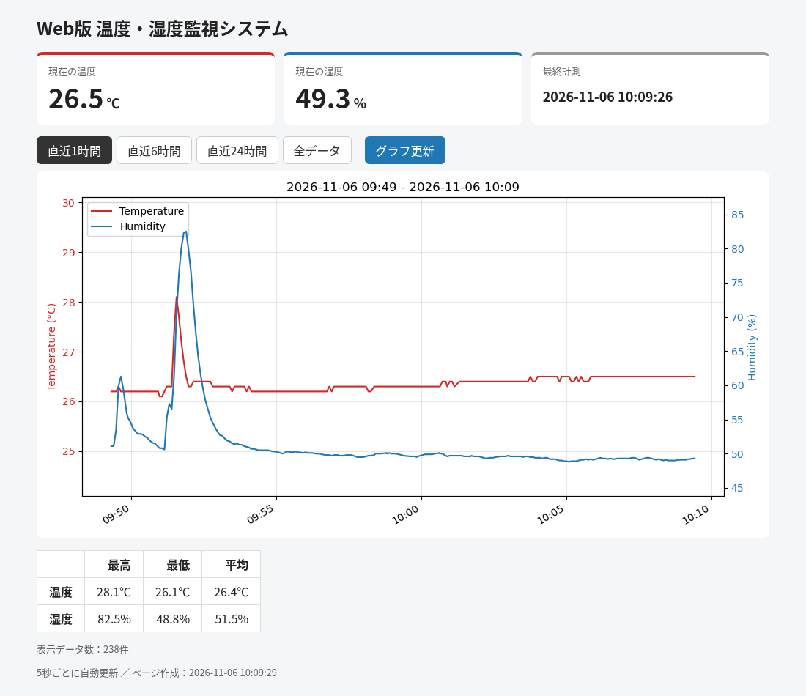

# Raspberry Pi

Raspberry Pi で GPIO やセンサーを動かす授業の課題・練習用プログラムです。



## 内容

| フォルダ / ファイル | 内容 | 使う部品 |
|---|---|---|
| [gpio_led_blink](gpio_led_blink/) | 課題1：GPIO26 の LED を 1 秒ごとに点滅 | LED、抵抗 |
| [gpio_button_led_toggle](gpio_button_led_toggle/) | タクトスイッチで LED をオン／オフ切り替え | LED、タクトスイッチ |
| [gpio_distance](gpio_distance/) | 距離センサーで距離 [cm] を表示（SPI） | GP2Y0A02、MCP3208 |
| [kyori](kyori/) | 距離センサーの練習用コピー | GP2Y0A02、MCP3208 |
| [ondo](ondo/) | 課題5：温度・湿度を 1 分ごとに CSV へ記録<br>課題6：Web版 温度・湿度監視システム（グラフ表示） | DHT11 |
| [plus1to5.py](plus1to5.py) | Python の for 文の練習 | なし |

## 動作環境

- Raspberry Pi（Raspberry Pi OS）
- Python 3
- RPi.GPIO（Raspberry Pi OS に標準で入っています）

フォルダごとに追加で必要なもの：

```bash
sudo apt install python3-spidev       # gpio_distance, kyori（SPI も有効にする）
sudo apt install python3-matplotlib   # ondo の課題6（グラフ作成）
```

## 使い方

```bash
git clone https://github.com/masteren/raspberry-pi.git
cd raspberry-pi/ondo        # 動かしたいフォルダへ移動
python3 kadai5.py           # 実行（Ctrl+C で終了）
```

接続方法や実行方法の詳細は、各フォルダの README を見てください。

## フォルダ構成

```
raspberry-pi/
├── gpio_led_blink/           課題1 LED 点滅
├── gpio_button_led_toggle/   スイッチで LED 切り替え
├── gpio_distance/            距離センサー
├── kyori/                    距離センサー（練習用）
├── ondo/                     温度・湿度センサー
│   ├── kadai5.py             課題5 計測して CSV に記録
│   ├── kadai5.csv            計測データ
│   ├── dht11/                DHT11 ライブラリ
│   ├── web/                  課題6 Web版 監視システム
│   │   ├── index.html
│   │   ├── style.css
│   │   ├── update.js
│   │   └── cgi-bin/graph.py
│   └── docs/screenshot.png
└── plus1to5.py
```
