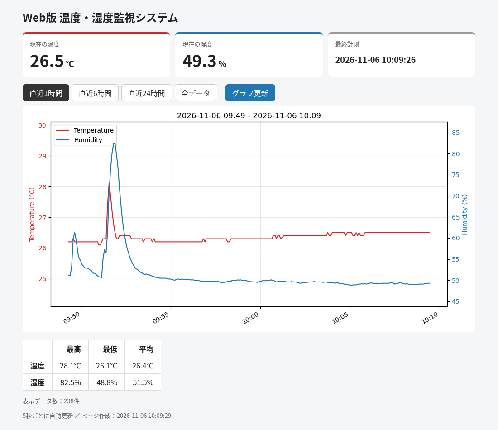

# 温度・湿度センサー（DHT11）

DHT11 を使った課題のフォルダです。

| 課題 | 内容 | 主なファイル |
|:---:|---|---|
| 課題5 | 温度・湿度自動計測システム（CSV に記録） | `kadai5.py`、`kadai5_1016.csv` |
| 課題6 | Web版 温度・湿度監視システム（CSV をグラフ表示） | `web/`、`kadai5.csv` |

課題6は課題5で作った CSV を使います。

## 共通：接続

- DHT11 の VCC → +5V
- DHT11 の DATA → GPIO26（DATA と +5V の間に 10kΩ のプルアップ抵抗）
- DHT11 の GND → GND
- NC ピンは未接続

共通で使うファイル：

- `sample.py`: 授業で配布されたサンプル（5 秒ごとに温度・湿度を表示）。配線の動作確認に使う
- `dht11/`: DHT11 読み取り用ライブラリ（配布資料の `dht11_sample.zip` より）

```bash
python3 sample.py   # 動作確認
```

---

## 課題5：温度・湿度自動計測システム

DHT11 で 1 分ごとに温度と湿度を計測し、CSV ファイルに追記保存します。

| ファイル | 内容 |
|---|---|
| `kadai5.py` | 計測プログラム |
| `kadai5_1016.csv` | 課題5で提出した計測データ（2026-10-16、1 分ごと、12 件） |
| `kadai5.csv` | `kadai5.py` の保存先。今は課題6のデモデータが入っている（下記） |

### CSV の形式

`時刻, 温度[℃], 湿度[%]`。文字コードは UTF-8、改行は CR+LF です。

```
2026-10-16 10:58:50, 25.1, 53.6
2026-10-16 10:59:50, 25.2, 52.1
```

### 仕様

- 計測間隔は 60 秒（`INTERVAL`）。計測にかかった時間を差し引いて、間隔がずれないようにしている
- 計測に失敗したときは CSV に書かず、画面に「計測エラー」と表示する
- `[Ctrl]+[C]` で終了し、GPIO を初期化する

### 実行方法

```bash
python3 kadai5.py
```

---

## 課題6：Web版 温度・湿度監視システム

課題5の `kadai5.csv` を読み込み、matplotlib でグラフを作ってブラウザに表示します。
Web サーバは Raspberry Pi 上で `python3 -m http.server --cgi` を使います。



| ファイル | 内容 |
|---|---|
| `web/index.html` | トップページ（`/cgi-bin/graph.py` へ移動） |
| `web/cgi-bin/graph.py` | CGI 本体。CSV を読み、`graph.png` を作成して HTML を出力 |
| `web/update.js` | ページを再読み込みせずにグラフと数値を自動更新（ちらつき防止） |
| `web/style.css` | 画面のデザイン |
| `kadai5.csv` | グラフにする計測データ（2026-11-06、376 件） |
| `docs/screenshot.png` | 画面のスクリーンショット |

### 機能

- 温度（左軸・赤）と湿度（右軸・青）の 2 軸グラフ
- 現在の温度・湿度と最終計測時刻をカード表示
- 表示範囲の切り替え：直近1時間 ／ 6時間 ／ 24時間 ／ 全データ（`graph.py?range=6h` など）
- 表示範囲内の最高・最低・平均を表で表示
- 5 秒ごとに自動更新、「グラフ更新」ボタンですぐに更新
- Python 3.13 以降で `import cgi` が使えないため、URL パラメータは環境変数 `QUERY_STRING` を `urllib.parse` で解析

### 準備

```bash
sudo apt install python3-matplotlib
```

### 実行方法

```bash
# 端末1：課題5のプログラムで計測して kadai5.csv に記録
python3 kadai5.py

# 端末2：Web サーバを起動（web フォルダで実行する）
cd web
python3 -m http.server --cgi 8080
```

> デモでは変化が早く見えるように、`kadai5.py` の `INTERVAL` を一時的に 5 秒にして計測しました。そのため `kadai5.csv` は 5 秒ごとのデータです。

ブラウザで `http://<ラズパイのIPアドレス>:8080/` を開きます（ラズパイ本体なら `http://localhost:8080/`）。
`graph.py` には実行権限が必要です（`chmod +x web/cgi-bin/graph.py`）。
